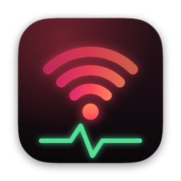
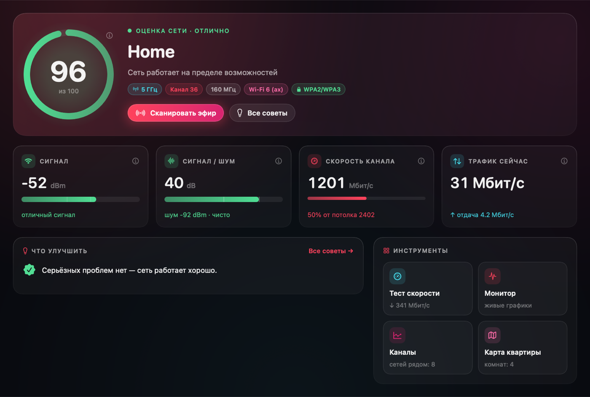
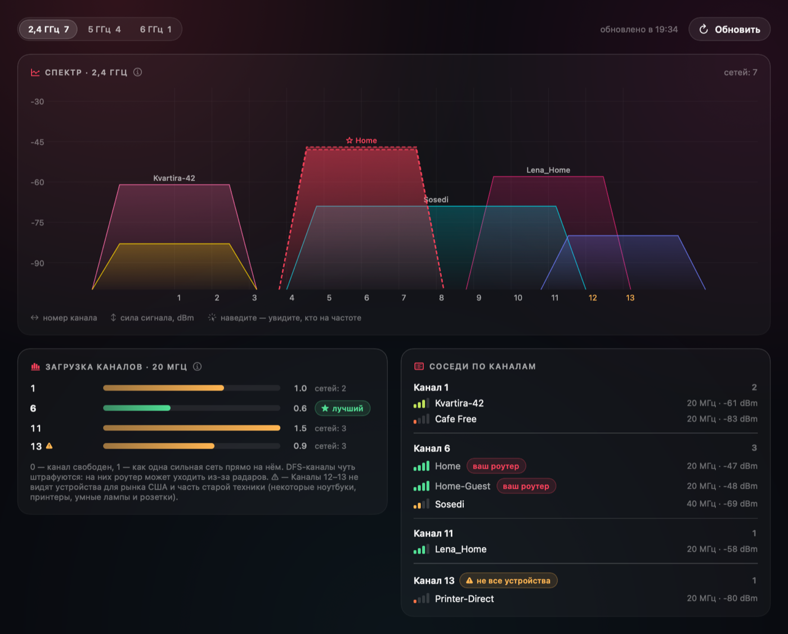
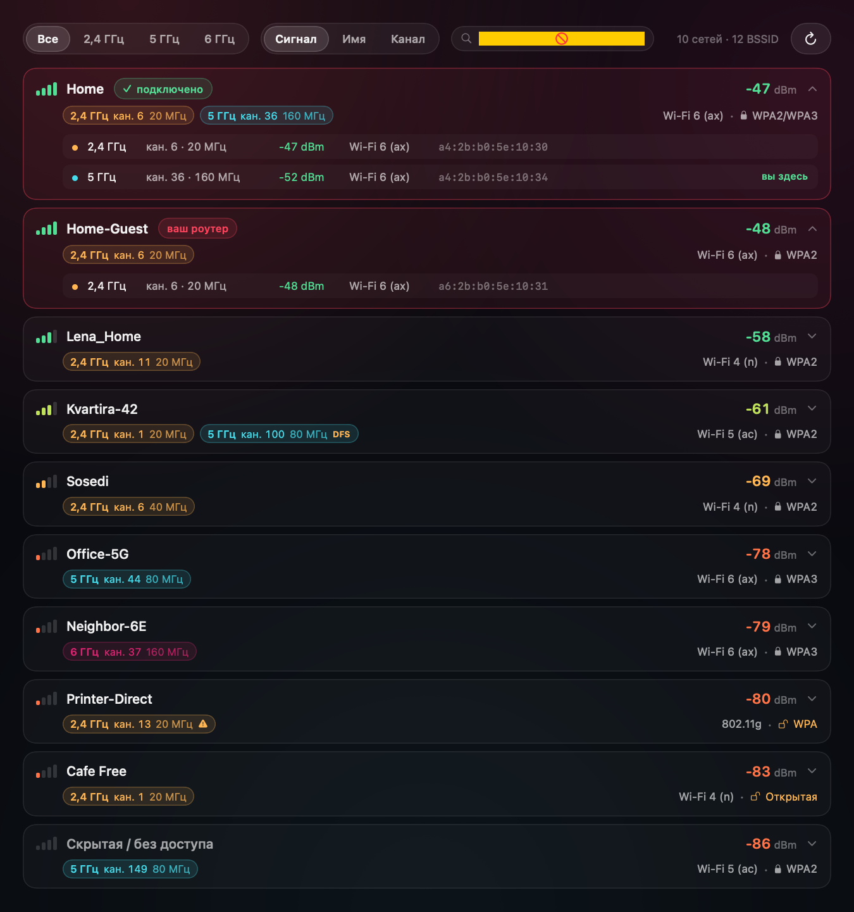
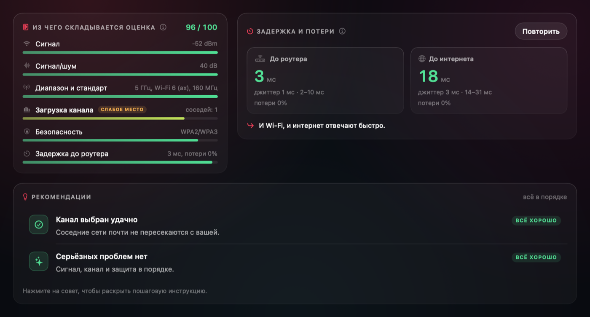
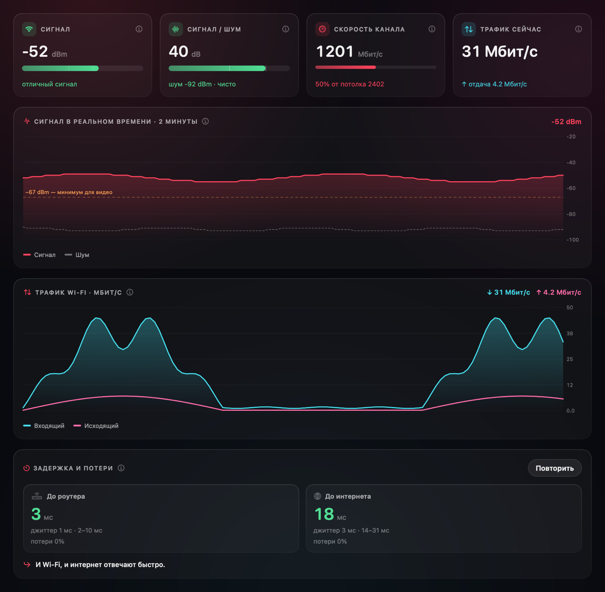
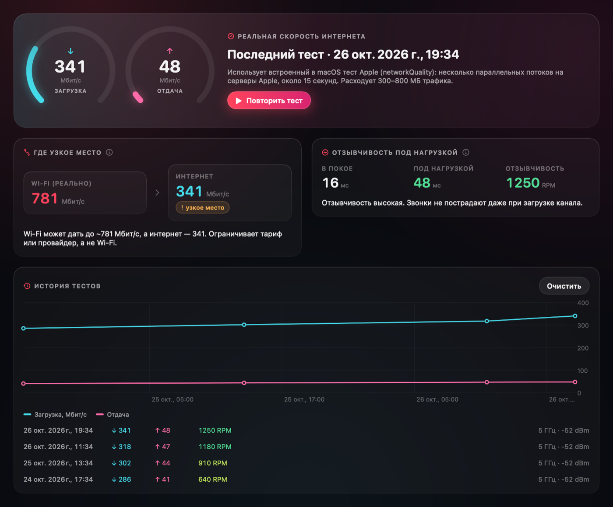
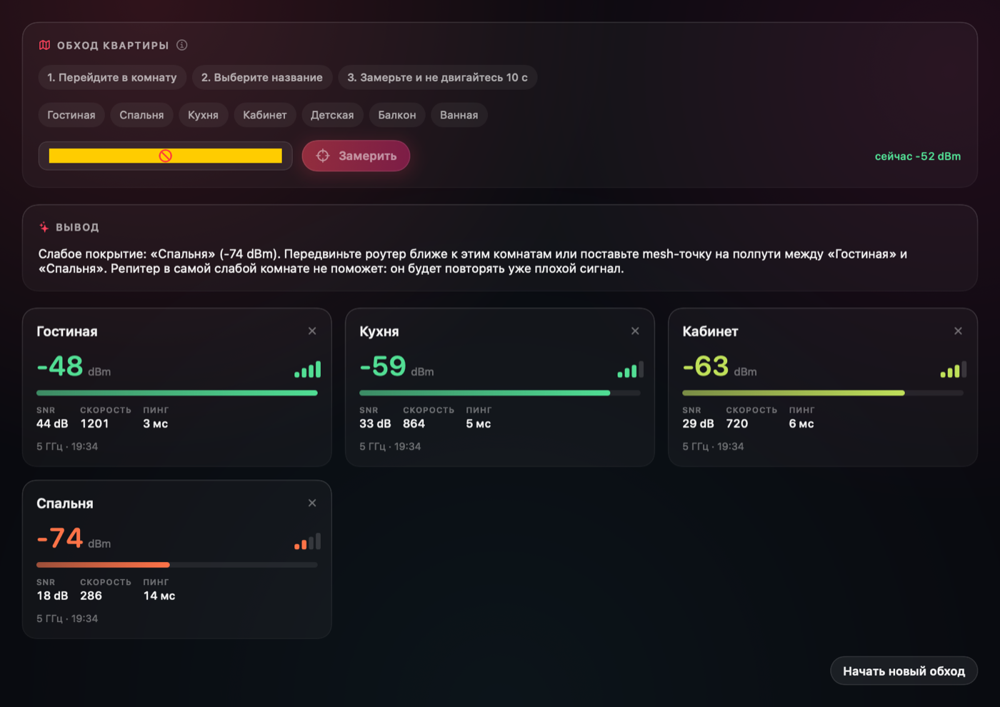
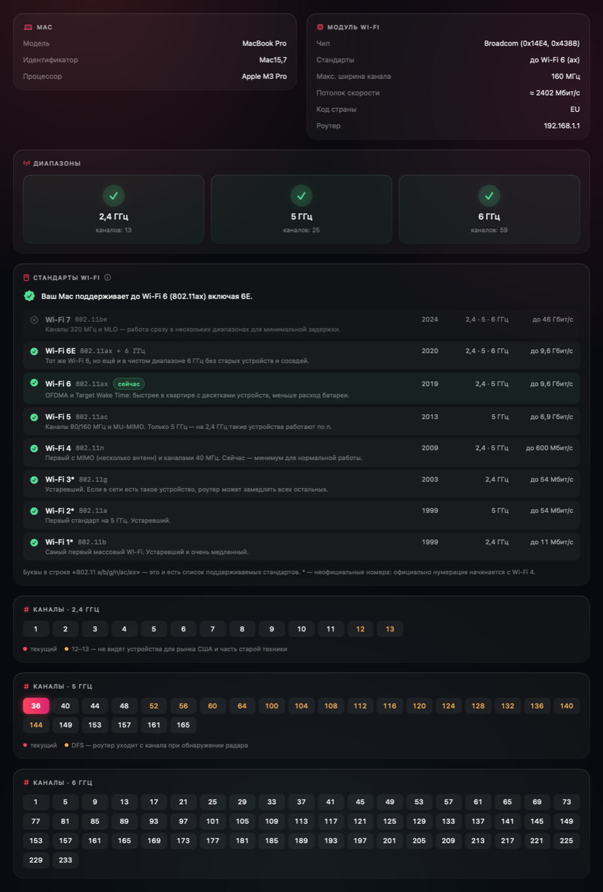
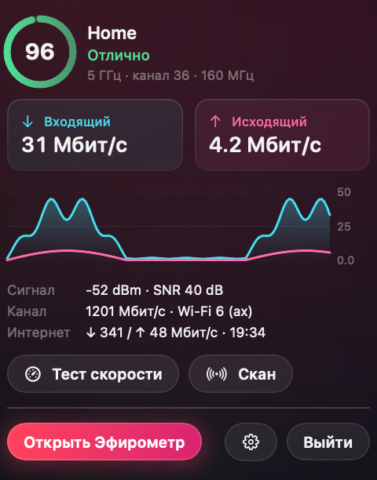

<div align="center">



# Эфирометр

**Понятная диагностика домашнего Wi‑Fi для Mac**

Оценка сети, каналы соседей, тест скорости, советы по настройке роутера<br>
и скорость интернета прямо в строке меню.

[](https://github.com/andrei-s96s/Efirometr/releases/latest)
[](https://github.com/andrei-s96s/Efirometr/actions/workflows/release.yml)


[](LICENSE)

### [⬇️ Скачать для macOS (.dmg)](https://github.com/andrei-s96s/Efirometr/releases/latest/download/Efirometr-macOS.dmg)

[.zip‑архив](https://github.com/andrei-s96s/Efirometr/releases/latest/download/Efirometr-macOS.zip) · [все релизы](https://github.com/andrei-s96s/Efirometr/releases) · [как установить](#установка)



</div>

---

## Зачем

Wi‑Fi тормозит, а непонятно почему? Эфирометр смотрит на сеть глазами инженера — сила сигнала, помехи, загрузка каналов соседями, стандарт, защита, задержка — и переводит всё это на человеческий язык. Не графики ради графиков, а **понятный диагноз и конкретные шаги**: какой канал выбрать в роутере, где поставить точку доступа, кто виноват — Wi‑Fi или провайдер.

## Что умеет

| | |
|---|---|
| 🩺 **Оценка сети от 0 до 100** | Сигнал, отношение сигнал/шум, диапазон и стандарт, загрузка канала, защита и задержка — и что из этого «слабое место». |
| 💡 **Советы с инструкциями** | «Смените канал 44 → 149», «включите WPA3», «перейдите на 5 ГГц» — каждый совет раскрывается в пошаговую инструкцию для роутера. |
| 📡 **Каналы и соседи** | Спектр 2,4 / 5 / 6 ГГц с «горбами» соседних сетей, загрузка каждого канала, лучший канал. Учитывает DFS и каналы 12–13, которые видят не все устройства. |
| 📶 **Сети вокруг** | Одна строка на сеть: все диапазоны и MAC‑адреса роутера вместе, mesh‑точки, стандарт и защита. Ваш роутер помечен и не считается помехой. |
| ⚡️ **Тест скорости** | Встроенный тест Apple (`networkQuality`): загрузка, отдача, отзывчивость под нагрузкой и вывод, где узкое место. |
| 📈 **Монитор и журнал** | Живые графики сигнала и трафика, история обрывов и задержек за 24 часа (по желанию, с паузой на батарее). |
| 🔔 **Уведомления** | Слабый сигнал, переход на 2,4 ГГц, обрыв Wi‑Fi, роутер перестал отвечать. |
| 🗺 **Карта квартиры** | Замеры по комнатам: где сигнал проседает и куда ставить роутер или mesh‑точку. |
| 🧩 **Трафик по приложениям** | Кто прямо сейчас занимает канал. |
| ↕️ **Скорость в строке меню** | Входящий и исходящий трафик всегда на виду, цветная иконка качества сигнала, мини‑панель по клику. |
| 📖 **Подсказки** | Кнопка ⓘ у каждой метрики объясняет, что она значит и какие значения нормальные. Стандарты Wi‑Fi расшифрованы: ax = Wi‑Fi 6 и т. д. |

## Скриншоты

<table>
<tr>
<td><br><sub><b>Каналы</b> — спектр, загрузка, лучший канал</sub></td>
<td><br><sub><b>Сети</b> — все диапазоны роутера в одной строке</sub></td>
</tr>
<tr>
<td><br><sub><b>Советы</b> — разбор оценки и инструкции</sub></td>
<td><br><sub><b>Монитор</b> — сигнал и трафик в реальном времени</sub></td>
</tr>
<tr>
<td><br><sub><b>Тест скорости</b> — где узкое место</sub></td>
<td><br><sub><b>Карта квартиры</b> — сигнал по комнатам</sub></td>
</tr>
<tr>
<td><br><sub><b>Устройство</b> — что умеет модуль Wi‑Fi вашего Mac</sub></td>
<td align="center"><br><sub><b>Строка меню</b> — скорость и мини‑панель</sub></td>
</tr>
</table>

<sub>На скриншотах демо‑данные: сети и адреса выдуманные.</sub>

## Установка

1. Скачайте **[Efirometr-macOS.dmg](https://github.com/andrei-s96s/Efirometr/releases/latest/download/Efirometr-macOS.dmg)** из [последнего релиза](https://github.com/andrei-s96s/Efirometr/releases/latest).
2. Откройте образ и перетащите **Эфирометр** в папку «Программы».
3. Первый запуск. Приложение не нотаризовано Apple, поэтому macOS его остановит:
   откройте **Системные настройки → Конфиденциальность и безопасность**, внизу нажмите **«Всё равно открыть»** у «Эфирометр».
   Либо одной командой в Терминале:
   ```bash
   xattr -dr com.apple.quarantine "/Applications/Эфирометр.app"
   ```
4. Разрешите **геолокацию** — без неё macOS скрывает имена Wi‑Fi сетей от всех приложений (координаты не используются). И **уведомления**, если они нужны.

Требования: **macOS 15 Sequoia или новее**, Apple Silicon или Intel.

## Приватность

- Все данные остаются на вашем Mac: журнал, замеры и история тестов лежат в `~/Library/Application Support/Efirometr`.
- Без аккаунтов, аналитики и рекламы.
- В сеть приложение ходит только когда вы просите: тест скорости — к серверам Apple (`networkQuality`), тест задержки — ping до вашего роутера и `1.1.1.1`.
- Геолокация нужна только потому, что macOS иначе не отдаёт имена сетей.

## Сборка из исходников

Нужен Xcode 16 или новее.

```bash
git clone https://github.com/andrei-s96s/Efirometr.git
cd Efirometr
./build-app.sh            # соберёт build/Эфирометр.app
./build-app.sh --install  # и установит в /Applications
```

Релизы собираются автоматически GitHub Actions при пуше тега `v*` ([`.github/workflows/release.yml`](.github/workflows/release.yml)).

<details>
<summary>Устройство проекта</summary>

- SwiftUI + AppKit, без сторонних зависимостей.
- `CoreWLAN` — сеть, сканирование, каналы; `sysctl` — счётчики трафика; `networkQuality`, `ping`, `nettop` — тесты и трафик по приложениям.
- `Analyzer.swift` — оценка и советы, `ChannelsView.swift` — спектр, `Live.swift` — лёгкие графики на Canvas (≈1% CPU).
- `Efirometr --demo --snapshot <папка>` — отрисовать все экраны на демо‑данных в PNG.

</details>

## Поддержать проект

Эфирометр бесплатный и развивается в свободное время. Если он помог — можно угостить автора кофе ☕️

<table>
<tr>
<td></td>
<td>

**USDT · сеть TRON (TRC20)**

```
TXaAjjkbDLFbFKS2pWfmneXzfRNZZgGWkW
```

⚠️ Отправляйте только **USDT в сети TRC20**. Перевод в другой сети (ERC20, BEP20 и т. п.) будет потерян.

</td>
</tr>
</table>

## Лицензия

[MIT](LICENSE) © Andrei Sych

---

<details>
<summary>🇬🇧 English</summary>

**Efirometr** is a free macOS app that explains your home Wi‑Fi in plain language: a 0–100 network score, step‑by‑step router advice, a 2.4/5/6 GHz channel spectrum with neighbouring networks, a speed test (Apple `networkQuality`), live signal/traffic charts, an optional 24 h journal with notifications, a room‑by‑room survey, per‑app traffic and upload/download speed in the menu bar. The UI is in Russian.

[Download the latest release](https://github.com/andrei-s96s/Efirometr/releases/latest) · requires macOS 15+, Apple Silicon or Intel. The app isn't notarized: allow it in *System Settings → Privacy & Security → Open Anyway* on first launch.

</details>
